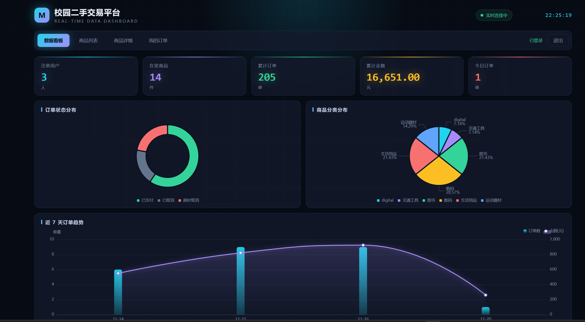
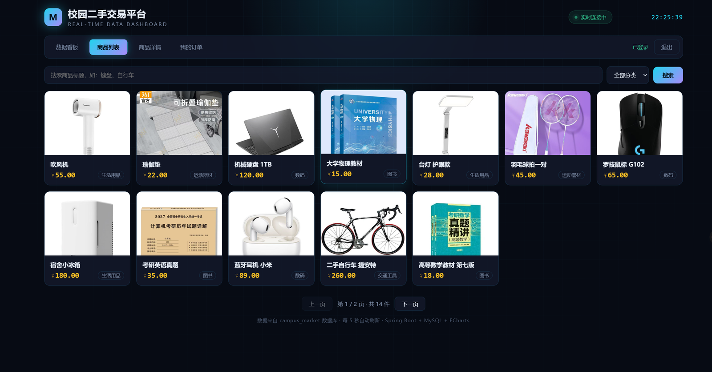
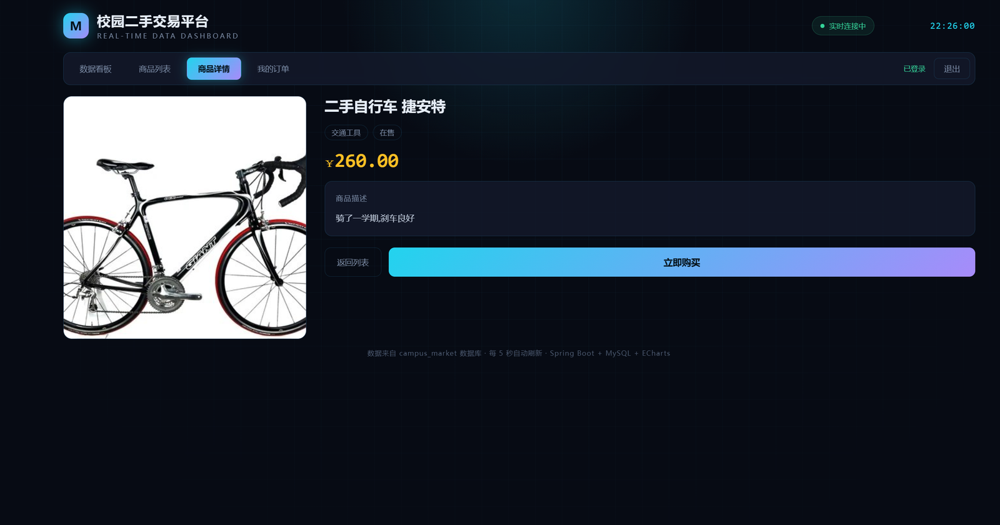
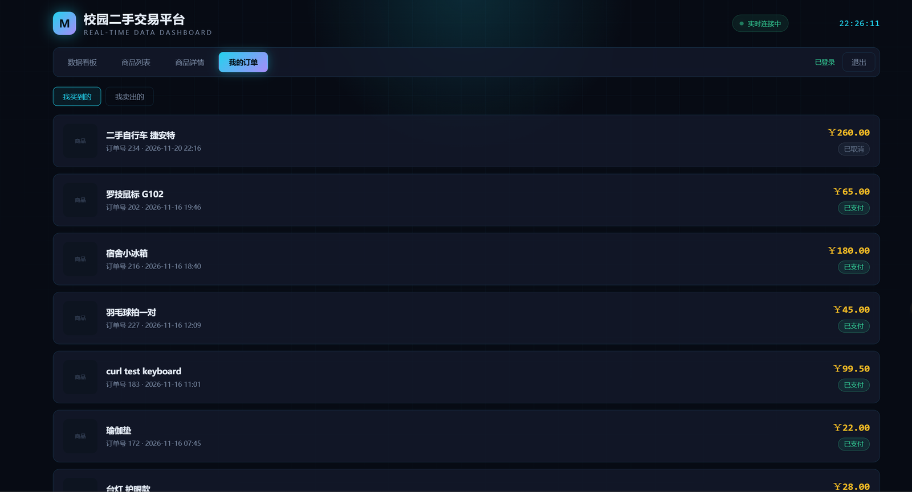

# 校园二手交易平台

面向校园场景的二手交易系统。**单页面应用**，一个链接内完成「浏览商品 → 查看详情 → 下单 → 管理订单」完整闭环，并集成实时运营数据看板。

**🚀 在线演示**：http://47.118.56.138:8080/dashboard.html

> 演示数据：13 件真实商品（含图片）、200+ 条订单。测试账号 `testuser` / `123456`

---

## 界面预览

### 数据看板
核心指标 + 订单状态分布 + 商品分类分布 + 近 7 天趋势 + 热门商品 TOP8



### 商品列表
搜索、分类筛选、分页，卡片展示商品图片与价格



### 商品详情
大图、描述、购买入口



### 我的订单
我买到的 / 我卖出的，订单状态与取消操作



---

## 功能

| 模块 | 功能 |
|---|---|
| **用户** | 注册、登录（JWT 无状态鉴权）、个人资料；密码 BCrypt 加盐哈希 |
| **商品** | 发布、图片上传、分页列表、分类/关键词动态查询、详情（Redis 缓存） |
| **订单** | 下单、取消、我的订单/我卖出的、状态机、超时自动取消 |
| **数据看板** | 5 个指标卡 + 4 张图表，5 秒自动刷新 |
| **前端** | 单页面（4 个视图切换）、深色主题、登录弹窗、响应式 |

---

## 技术栈

| 分类 | 技术 |
|---|---|
| 语言 | Java 17 |
| 框架 | Spring Boot 3.4.5 |
| 持久层 | MyBatis-Plus 3.5.9（含 mybatis-plus-jsqlparser 3.5.9） |
| 数据库 | MySQL 8.0 |
| 缓存 | Redis（商品详情 Cache-Aside） |
| 鉴权 | JWT（jjwt 0.11.5）+ 拦截器 |
| 加密 | BCrypt（jbcrypt 0.4） |
| 文件存储 | 本地磁盘（配置项外置，支持多环境） |
| 前端 | 原生 HTML/CSS/JS + ECharts 5（无构建、无框架） |
| 部署 | 阿里云 ECS（Ubuntu 22.04）+ systemd |

---

## 架构

```
浏览器（单页面 dashboard.html）
      │  ① 视图切换：看板 / 商品 / 详情 / 订单
      ▼
 ┌──────────────────────────────────────────────────┐
 │  AuthInterceptor  JWT 验签 → request.setAttribute │
 └──────────────────────────────────────────────────┘
      │
      ├── UserController   → UserService   → UserMapper   ─┐
      ├── ProductController→ ProductService→ ProductMapper ├─→ MySQL
      │                       └→ Redis（详情缓存）          │
      ├── OrderController  → OrderService  → OrderMapper   │
      │                       └→ @Scheduled 超时取消        │
      ├── UploadController → 本地磁盘 → /uploads/** 静态映射│
      └── StatsController  → StatsService  → StatsMapper  ─┘

 统一返回 {code, message, data} + 全局异常处理
```

**分层职责**：Controller 只做参数接收与结果包装；Service 承载全部业务规则；Mapper 只负责数据访问。业务异常统一 `throw RuntimeException`，由 `GlobalExceptionHandler` 收敛为标准响应。

---

## 数据库设计

三张表：`user` / `product` / `order`

### 索引设计（按实际查询路径建立）

| 表 | 索引 | 用途 |
|---|---|---|
| user | `username`（唯一） | 登录 / 注册查重 |
| product | `idx_seller` | 查某卖家发布的商品 |
| product | `idx_category` | 按分类筛选 |
| order | `idx_buyer (buyer_id, status)` | 我的订单（买家视角） |
| order | `idx_seller (seller_id, status)` | 我卖出的（卖家视角） |
| order | `idx_timeout (status, create_time)` | **定时任务扫描超时订单** |

最后一项与业务强绑定：定时任务查询条件是 `WHERE status = 0 AND create_time < ?`，
联合索引让每分钟一次的扫描走索引而非全表。

### 订单状态机

```
0 待支付 ──支付──→ 1 已支付
   │
   ├──用户取消──→ 2 已取消
   └──超时30分钟──→ 3 超时取消
```

状态流转在 Service 层校验，非法流转直接抛业务异常。

---

## 接口清单

统一返回：

```json
{ "code": 200, "message": "success", "data": {} }
```

除注册/登录/看板/商品浏览/图片访问外，均需请求头 `Authorization: <token>`。

### 用户

| 方法 | 路径 | 说明 | 鉴权 |
|---|---|---|---|
| POST | `/api/user/register` | 注册 | ❌ |
| POST | `/api/user/login` | 登录，返回 token | ❌ |
| GET | `/api/user/profile` | 当前用户资料 | ✅ |

### 商品

| 方法 | 路径 | 说明 | 鉴权 |
|---|---|---|---|
| POST | `/api/product` | 发布商品 | ✅ |
| GET | `/api/product/list?page&size&category&keyword` | 分页+动态条件 | ❌ 公开 |
| GET | `/api/product/{id}` | 详情（走 Redis 缓存） | ❌ 公开 |

### 订单

| 方法 | 路径 | 说明 |
|---|---|---|
| POST | `/api/order` | 下单 body `{"productId":1}` |
| PUT | `/api/order/{orderId}/cancel` | 取消订单 |
| GET | `/api/order/my?page&size` | 我的订单 |
| GET | `/api/order/sales?page&size` | 我卖出的 |

### 上传

| 方法 | 路径 | 说明 |
|---|---|---|
| POST | `/api/upload/image` | 图片上传（form-data: `file`） |

### 统计

| 方法 | 路径 | 说明 |
|---|---|---|
| GET | `/api/stats/dashboard` | 看板全部数据（一次请求） |

---

## 关键设计说明

### 1. 身份只认 token，不认请求参数
发布商品时的 `sellerId` 取自拦截器写入的 `request.getAttribute("userId")`，
不接收前端传值。下单同理。避免"传别人的 id 就能替别人操作"的越权问题。

### 2. Redis 缓存与一致性
`getById` 采用 Cache-Aside 模式：先查 Redis → 未命中查 MySQL → 回写并设 30 分钟 TTL。
写入时提供 `evictCache(id)`，商品更新/下架时删除对应 key，把不一致窗口
从"最长 30 分钟"压缩到毫秒级。

**验证方式**：连续两次请求同一商品详情，第一次控制台有 `SELECT`，第二次没有。

### 3. 定时任务与超时订单
`@Scheduled(cron = "0 * * * * ?")` 每分钟扫描一次，把 30 分钟未支付的订单置为超时取消。

不用"下单时开线程 sleep 30 分钟"的原因：
- 项目重启线程丢失，任务永久丢失；
- 一万个订单就是一万个线程，资源不可控；
- 每分钟扫描无状态、可重启、可水平扩展。

### 4. 分页的隐性坑
MyBatis-Plus 3.5.9 起，`PaginationInnerInterceptor` 被拆分到独立依赖
`mybatis-plus-jsqlparser`。**缺少该依赖时分页不报错**，但 `LIMIT` 不会拼进 SQL，
实际返回全表——属于静默失效。自查方式：看控制台 SQL 是否有 `LIMIT`，
或比较 `total` 与 `records.size()`。

### 5. 图片上传的安全设计
- **UUID 重命名**：防同名覆盖，也防文件名夹带路径（`../../etc/passwd`）的路径穿越攻击
- **后端自校验**：扩展名白名单 + 大小限制，不信任前端
- **返回相对路径**：换服务器或加 CDN 时数据库不用改
- **存储目录外置**：`upload.dir` 配置项，本地 Windows 路径、服务器 Linux 路径共用一套代码

### 6. 统一异常处理
业务代码只负责 `throw new RuntimeException("商品已被占用")`，
`@RestControllerAdvice` 统一捕获并包装为 `{code:500, message:"...", data:null}`。
连请求体 JSON 格式错误也落在这个体系内，前端拿到的永远是固定结构。

---

## 本地运行

### 环境要求
- JDK 17
- MySQL 8（库 `campus_market`）
- Redis（先启动）
- Maven（或使用项目自带 `mvnw`）

### 步骤

1. 建库并导入表结构：

```sql
CREATE DATABASE campus_market DEFAULT CHARACTER SET utf8mb4;
```

2. 复制配置模板，填入自己的数据库账号密码：

```bash
cp src/main/resources/application.yml.example src/main/resources/application.yml
```

3. 启动：

```bash
./mvnw spring-boot:run
```

4. 访问：http://localhost:8080/dashboard.html

### 配置说明

```yaml
spring:
  servlet:
    multipart:
      max-file-size: 5MB        # 单文件上限
      max-request-size: 10MB    # 单请求上限

upload:
  dir: C:/Users/lqx/uploads/    # 本地; 服务器改为 /root/uploads/
```

---

## 服务器部署（systemd）

```bash
# 打包
./mvnw clean package -DskipTests

# 上传后，用外部配置启动，避免密码进代码仓库
java -jar market-0.0.1-SNAPSHOT.war --spring.config.location=file:/root/application.yml
```

常驻服务（`/etc/systemd/system/market.service`）：

```ini
[Service]
Type=simple
WorkingDirectory=/root
ExecStart=/usr/bin/java -jar /root/market-0.0.1-SNAPSHOT.war --spring.config.location=file:/root/application.yml
Restart=always
RestartSec=10
StandardOutput=append:/root/market.log
StandardError=append:/root/market.log
```

`Restart=always` 保证进程异常退出后自动拉起；日志追加写入便于排查。

**图片目录需单独创建并上传**（不在 war 包内）：

```bash
mkdir -p /root/uploads
# 本地传图: scp -r C:\Users\lqx\uploads\* root@IP:/root/uploads/
```

---

## 说明

项目中的商品与订单数据为演示数据，用于展示交易流程与统计看板功能。
