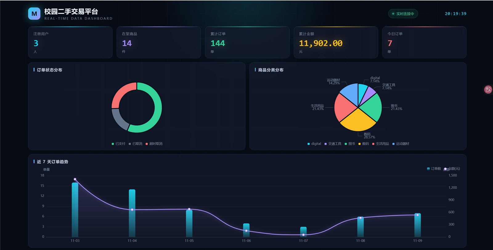

# 校园二手交易平台

一个面向校园场景的二手交易后端系统，包含用户、商品、订单三个核心业务模块，
并附带一个实时运营数据看板。

**线上演示**：http://47.118.56.138:8080/dashboard.html




---

## 功能

### 用户模块
- 注册 / 登录（JWT 无状态鉴权）
- 密码 BCrypt 加盐哈希存储，数据库不存明文
- 个人资料查询（需要登录态）

### 商品模块
- 发布商品（卖家身份取自 token，不信任前端传参）
- 分页列表 + 分类 / 关键词动态条件查询
- 商品详情（Redis 缓存，30 分钟 TTL）

### 订单模块
- 下单（校验商品存在、在售、不能购买自己的商品）
- 取消订单（校验归属与状态流转）
- 我的订单 / 我卖出的订单（分页）
- **超时自动取消**：定时任务每分钟扫描，30 分钟未支付自动置为"超时取消"

### 数据看板
- 核心指标：注册用户、在架商品、累计订单、累计金额、今日订单
- 订单状态分布、商品分类分布、近 7 天订单趋势、热门商品 TOP 8
- 每 5 秒自动刷新，数据来自实时聚合查询

---

## 技术栈

| 分类 | 技术 |
|---|---|
| 语言 / 运行时 | Java 17 |
| 框架 | Spring Boot 3.4.5、Spring MVC |
| 持久层 | MyBatis-Plus 3.5.9（含分页插件） |
| 数据库 | MySQL 8 |
| 缓存 | Redis（商品详情缓存） |
| 鉴权 | JWT（jjwt 0.11.5）+ 拦截器 |
| 加密 | BCrypt |
| 前端 | 原生 HTML/CSS/JS + ECharts 5 |
| 部署 | 阿里云 ECS（Ubuntu 22.04）+ systemd |

---

## 架构

```
浏览器 / Apifox
      │
      ▼
 ┌─────────────────────────────────────────┐
 │  AuthInterceptor  (JWT 验签，注入 userId) │
 └─────────────────────────────────────────┘
      │
      ├── UserController  → UserService  → UserMapper  ─┐
      ├── ProductController → ProductService → ──────────┤
      │                        │                        ├──→ MySQL
      │                        └──→ Redis（详情缓存）     │
      ├── OrderController  → OrderService → OrderMapper ─┤
      │                        └── @Scheduled 超时取消    │
      └── StatsController  → StatsService → StatsMapper ─┘

 统一返回 {code, message, data} + 全局异常处理
```

**分层职责**：Controller 只做参数接收与结果包装；Service 承载全部业务规则；
Mapper 只负责数据访问。业务异常统一 `throw RuntimeException`，由
`GlobalExceptionHandler` 收敛为标准响应。

---

## 数据库设计

三张表：`user`、`product`、`order`。

**索引设计**（按实际查询路径建立）：

| 表 | 索引 | 用途 |
|---|---|---|
| user | `username` (唯一) | 登录 / 注册查重 |
| product | `idx_seller` | 查某卖家发布的商品 |
| product | `idx_category` | 按分类筛选 |
| order | `idx_buyer (buyer_id, status)` | 我的订单（买家视角） |
| order | `idx_seller (seller_id, status)` | 我卖出的订单（卖家视角） |
| order | `idx_timeout (status, create_time)` | **定时任务扫描超时订单** |

最后一个是与业务强绑定的设计：定时任务的查询条件是
`WHERE status = 0 AND create_time < ?`，联合索引让这次每分钟一次的扫描走索引而非全表。

**订单状态机**：

```
0 待支付 ──支付──→ 1 已支付
   │
   ├──用户取消──→ 2 已取消
   └──超时30分钟──→ 3 超时取消
```

状态流转在 Service 层校验，非法流转直接抛业务异常。

---

## 接口清单

所有接口统一返回：

```json
{ "code": 200, "message": "success", "data": {} }
```

除注册 / 登录 / 看板外，均需请求头 `Authorization: <token>`。

### 用户

| 方法 | 路径 | 说明 |
|---|---|---|
| POST | `/api/user/register` | 注册 |
| POST | `/api/user/login` | 登录，返回 token |
| GET | `/api/user/profile` | 当前用户资料 |

### 商品

| 方法 | 路径 | 说明 |
|---|---|---|
| POST | `/api/product` | 发布商品 |
| GET | `/api/product/list?page=1&size=5&category=&keyword=` | 分页 + 动态条件 |
| GET | `/api/product/{id}` | 详情（走 Redis 缓存） |

### 订单

| 方法 | 路径 | 说明 |
|---|---|---|
| POST | `/api/order` | 下单，body: `{"productId":1}` |
| PUT | `/api/order/{orderId}/cancel` | 取消订单 |
| GET | `/api/order/my?page=1&size=10` | 我的订单 |
| GET | `/api/order/sales?page=1&size=10` | 我卖出的 |

### 统计

| 方法 | 路径 | 说明 |
|---|---|---|
| GET | `/api/stats/dashboard` | 看板全部数据（一次请求） |

---

## 关键设计说明

### 1. 身份只认 token，不认请求参数
发布商品时的 `sellerId` 从拦截器写入的 `request.getAttribute("userId")` 取，
不接收前端传值。下单同理。避免"传别人的 id 就能替别人操作"的越权问题。

### 2. Redis 缓存与一致性
`getById` 采用 Cache-Aside 模式：先查 Redis → 未命中查 MySQL → 回写并设 30 分钟 TTL。
写入时提供 `evictCache(id)`，在商品更新 / 下架时删除对应 key，把不一致窗口
从"最长 30 分钟"压缩到毫秒级。

**验证方式**：连续两次请求同一商品详情，第一次控制台有 `SELECT`，第二次没有——
缓存命中，请求未落库。

### 3. 定时任务与超时订单
`@Scheduled(cron = "0 * * * * ?")` 每分钟扫描一次。

不用"下单时开线程睡 30 分钟"的原因：
- 项目重启线程丢失，任务永久丢失；
- 一万个订单就是一万个线程，资源不可控；
- 每分钟扫描是无状态、可重启、可水平扩展的方案。

生产环境更常见的做法是延迟消息（如 RocketMQ 延迟队列），此处为单机简化实现。

### 4. 分页的隐性坑
MyBatis-Plus 3.5.9 起，`PaginationInnerInterceptor` 被拆分到独立依赖
`mybatis-plus-jsqlparser`。**缺少该依赖时分页不会报错**，但 `LIMIT` 不会拼进 SQL，
实际返回全表数据——属于静默失效。自查方式：看控制台 SQL 是否有 `LIMIT`，
或比较 `total` 与 `records.size()` 是否相等。

### 5. 统一异常处理
业务代码只负责 `throw new RuntimeException("用户名已被占用")`，
`@RestControllerAdvice` 统一捕获并包装为 `{code:500, message:"...", data:null}`。
连请求体 JSON 格式错误（`HttpMessageNotReadableException`）也落在这个体系内，
前端拿到的永远是固定结构。

---

## 本地运行

### 环境要求
- JDK 17
- MySQL 8
- Redis
- Maven（或使用项目自带 `mvnw`）

### 步骤

1. 建库并导入表结构：

```sql
CREATE DATABASE campus_market DEFAULT CHARACTER SET utf8mb4;
```

2. 复制配置模板，填入自己的数据库账号密码：

```bash
cp src/main/resources/application.yml.example src/main/resources/application.yml
```

3. 启动：

```bash
./mvnw spring-boot:run
```

4. 访问看板：http://localhost:8080/dashboard.html

---

## 服务器部署（systemd）

```bash
# 打包
./mvnw clean package -DskipTests

# 上传后，用外部配置启动，避免密码进代码仓库
java -jar market-0.0.1-SNAPSHOT.war --spring.config.location=file:/root/application.yml
```

常驻服务用 systemd 管理（`/etc/systemd/system/market.service`）：

```ini
[Service]
Type=simple
WorkingDirectory=/root
ExecStart=/usr/bin/java -jar /root/market-0.0.1-SNAPSHOT.war --spring.config.location=file:/root/application.yml
Restart=always
RestartSec=10
StandardOutput=append:/root/market.log
StandardError=append:/root/market.log
```

`Restart=always` 保证进程异常退出后自动拉起；日志追加写入便于排查。

---

## 说明

项目中的商品与订单数据为演示数据，用于展示统计与看板功能。
